# `wjp_funnel()` examples

One chart for each argument of `wjp_funnel()`. From the repository root, run:

```sh
Rscript examples/funnel.R
```

The script loads the local package with `pkgload`, registers the WJP fonts
with `wjp_fonts(engine = "systemfonts")`, and saves every chart as
`examples/funnel_<name>.png` with `wjp_save()` (200 dpi). All values are
fictional.

Every funnel keeps the same spacing and connectors as the basic one: bars are
always 18 points apart, and connectors are drawn at an opacity of 0.45. The
former `gap` and `connector_alpha` arguments are deprecated and ignored.

Most examples use the same four stages and a 6.5 in figure
(`width = 468` points):

```r
journey <- data.frame(
  stage = c("Experienced a legal problem",
            "Had access to information and advice",
            "Obtained appropriate assistance\nwhen they needed it",
            "Turned to a dispute resolution\nmechanism when they needed it"),
  value = c(78.3, 61.4, 31.9, 28.5),
  rank  = c(1, 2, 3, 4)
)
journey$text <- paste0(round(journey$value), "%")

funnel <- function(data = journey, ...) {
  wjp_funnel(data, target = "value", grouping = "stage", width = 468, ...)
}
```

| # | Example | Arguments |
| --- | --- | --- |
| 1 | [Basic](#1-basic) | `target`, `grouping` |
| 2 | [Printed labels](#2-printed-labels) | `labels` |
| 3 | [Display order](#3-display-order) | `order` |
| 4 | [Missing value](#4-missing-value) | `NA` in `target` |
| 5 | [Many stages](#5-many-stages) | six rows |
| 6 | [Single stage](#6-single-stage) | one row |
| 7 | [Short bars](#7-short-bars) | `bar_height` |
| 8 | [Tall bars](#8-tall-bars) | `bar_height` |
| 9 | [Narrow figure](#9-narrow-figure) | `width` |
| 10 | [Fixed bar area](#10-fixed-bar-area) | `panel_width` |
| 11 | [Fill the device](#11-fill-the-device) | no `width` or `panel_width` |
| 12 | [Margins](#12-margins) | `margins` |
| 13 | [No connectors](#13-no-connectors) | `connectors` |
| 14 | [Connector color](#14-connector-color) | `connector_color` |
| 15 | [Bar color](#15-bar-color) | `color` |
| 16 | [Value face](#16-value-face) | `value_face` |
| 17 | [Value size and color](#17-value-size-and-color) | `value_size`, `value_color` |
| 18 | [Label size and color](#18-label-size-and-color) | `label_size`, `label_colour` |
| 19 | [Wrapped labels](#19-wrapped-labels) | `label_width` |
| 20 | [One-line labels](#20-one-line-labels) | no `label_width` |
| 21 | [Label gap](#21-label-gap) | `label_gap` |
| 22 | [Label line height](#22-label-line-height) | `label_lineheight` |
| 23 | [Theme](#23-theme) | `ptheme` |
| 24 | [Everything together](#24-everything-together) | all arguments |

## Data

### 1. Basic

Only the required arguments. Without `labels`, values print as rounded
percentages of `target`, and stages are drawn in data order. The widest bar
spans the bar area; the others are scaled to it and centered.

```r
funnel()
```


### 2. Printed labels

`labels` names a column printed as given (no reformatting).

```r
labelled$text <- paste0(formatC(labelled$value, format = "f", digits = 1), "%")
funnel(labelled, labels = "text")
```

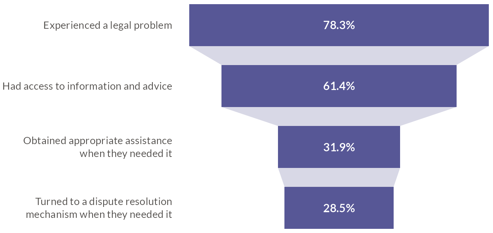

### 3. Display order

`order` names a column with the display order, top to bottom. Here the
smallest stage goes first, so the funnel widens downwards.

```r
ascending$rank <- rank(ascending$value)
funnel(ascending, labels = "text", order = "rank")
```

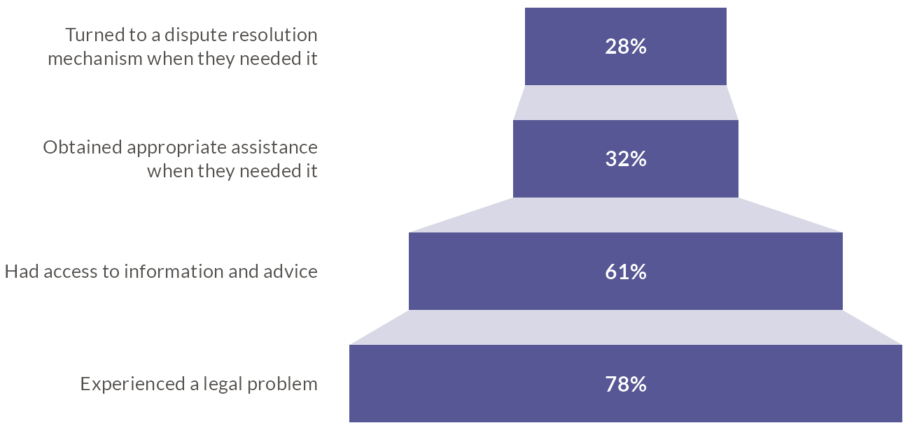

### 4. Missing value

A stage with `NA` in `target` draws no bar and no value; its label stays, and
the connectors meet at the center.

```r
missing$value[3] <- NA
funnel(missing)
```

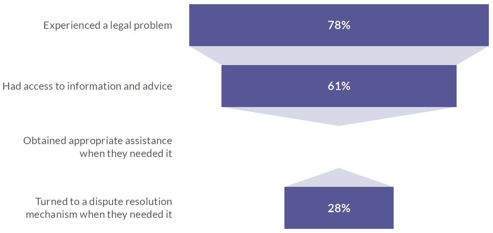

### 5. Many stages

Any number of rows works. Lower bars keep six stages compact.

```r
funnel(six, bar_height = 30)
```

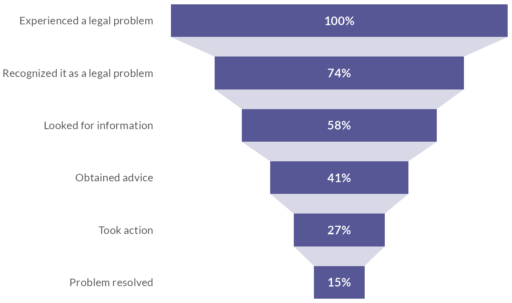

### 6. Single stage

With one row, no connectors are drawn.

```r
funnel(journey[1, ])
```


## Geometry

Bars are always 18 points apart; their height, the figure width, and the
margins can change.

### 7. Short bars

`bar_height` is in points (default `40`).

```r
funnel(labels = "text", bar_height = 24)
```


### 8. Tall bars

```r
funnel(labels = "text", bar_height = 56)
```

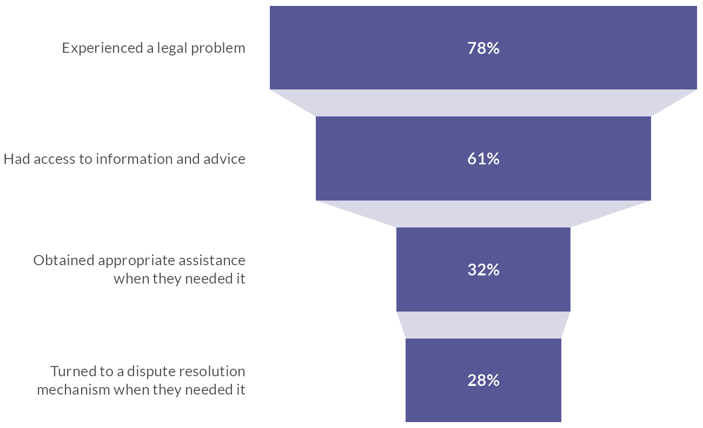

### 9. Narrow figure

`width` is the total figure width in points (here 4.5 in). The bar area
takes what the label column and the margins leave.

```r
wjp_funnel(journey, "value", "stage", labels = "text", width = 324)
```

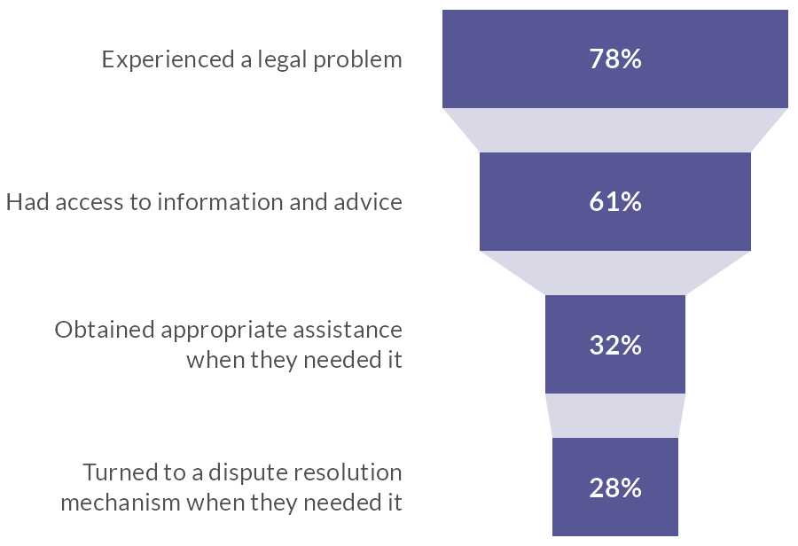

### 10. Fixed bar area

`panel_width` fixes the bar area in points; the figure width follows from the
label column. Supply only one of `width` and `panel_width`.

```r
wjp_funnel(journey, "value", "stage", labels = "text", panel_width = 200)
```

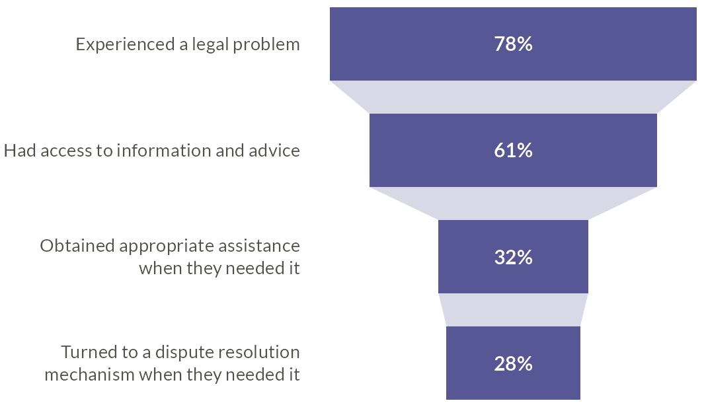

### 11. Fill the device

Without `width` or `panel_width` the bars fill the device width, so
`wjp_save()` needs a size. The height is still fixed by the bars (4 × 40 +
3 × 18 + 8 pt of margins = 222 pt).

```r
p <- wjp_funnel(journey, "value", "stage", labels = "text")
wjp_save(p, "funnel_fill_device.png", width = 576, height = 222, units = "pt")
```

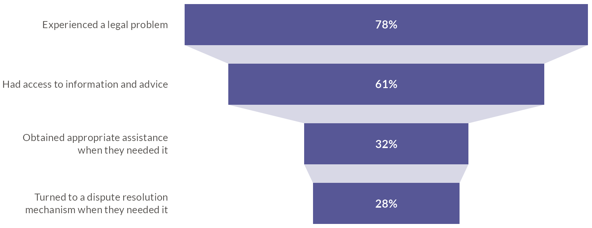

### 12. Margins

`margins` are four numbers in points (top, right, bottom, left; default
`c(4, 4, 4, 2)`). The border is a `ptheme` background, there only to show
the margins.

```r
framed <- WJP_theme() +
  ggplot2::theme(plot.background = ggplot2::element_rect(fill = NA, colour = "#A8A8C8"))
funnel(labels = "text", margins = c(24, 24, 24, 24), ptheme = framed)
```

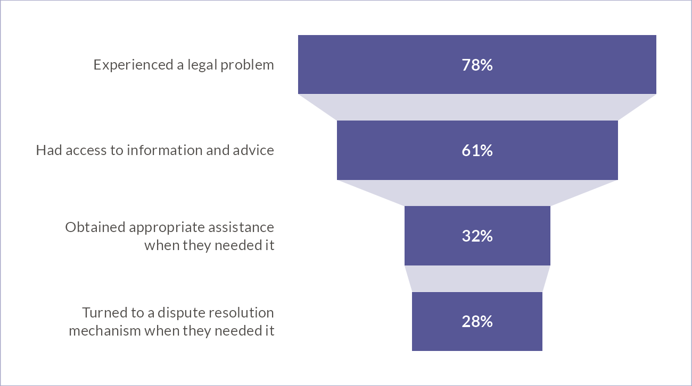

## Connectors

Connectors are always drawn at an opacity of 0.45, so they stay lighter than
the bars.

### 13. No connectors

```r
funnel(labels = "text", connectors = FALSE)
```

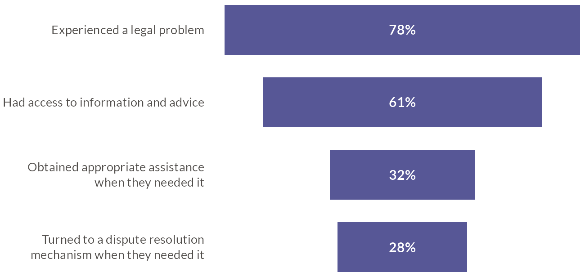

### 14. Connector color

`connector_color` (default `"#A8A8C8"`).

```r
funnel(labels = "text", connector_color = "#f26b21")
```

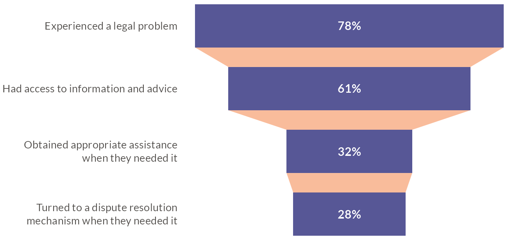

## Bars and values

### 15. Bar color

`color` sets one color for every bar (default `"#575796"`). Give the
connectors the same hue with `connector_color`; they are drawn lighter.

```r
funnel(labels = "text", color = "#2894aa", connector_color = "#2894aa")
```

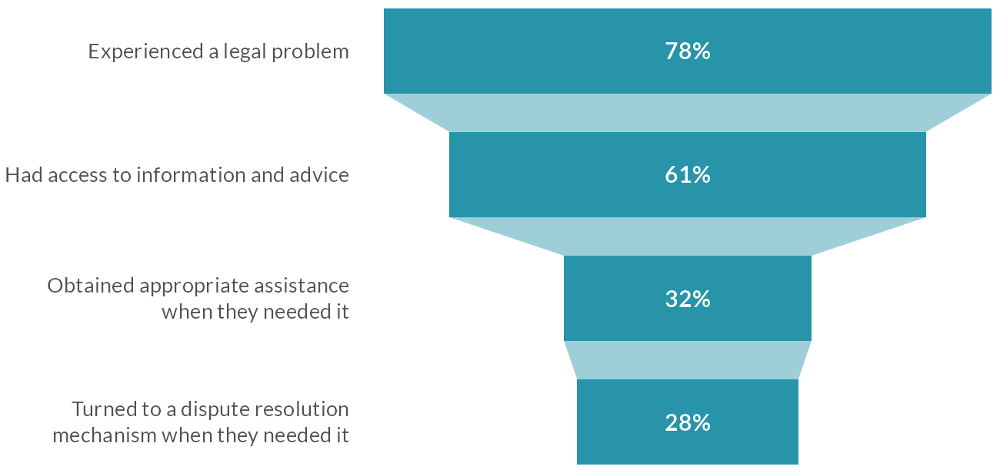

### 16. Value face

`value_face` accepts `"plain"`, `"bold"` (default), `"italic"`,
`"bold.italic"`, `"medium"`, `"medium.italic"`, `"semibold"`, and
`"semibold.italic"`. Weight faces fall back to bold when the font has no such
weight.

```r
funnel(labels = "text", value_face = "semibold.italic")
```


### 17. Value size and color

`value_size` in points (default `11`) and `value_color` (default white). Use
a dark value color on light bars.

```r
funnel(labels = "text", color = wjp_colors()[["eu"]],
       value_size = 14, value_color = wjp_colors()[["text"]])
```

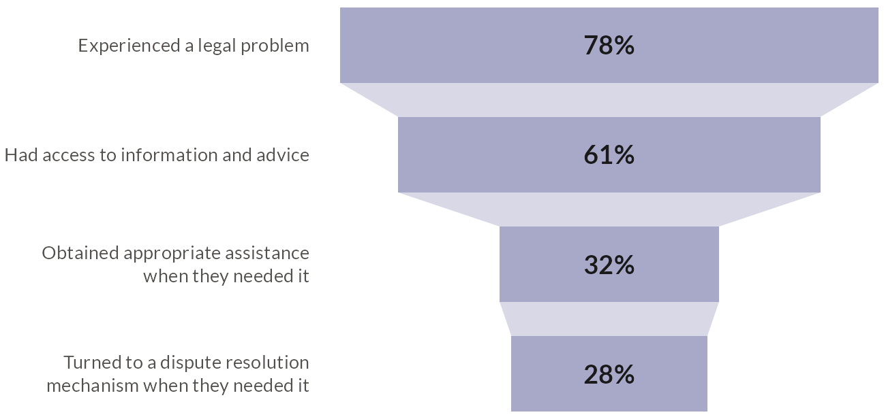

## Stage labels

### 18. Label size and color

`label_size` in points (default `10`) and `label_colour` (default
`"#524F4C"`).

```r
funnel(labels = "text", label_size = 12, label_colour = "#1A1A1A")
```

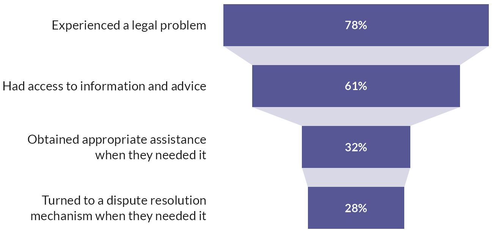

### 19. Wrapped labels

`label_width` wraps labels without line breaks to a width in points. Labels
that contain `"\n"` keep their own breaks.

```r
one_line$stage <- gsub("\n", " ", one_line$stage, fixed = TRUE)
funnel(one_line, labels = "text", label_width = 120)
```

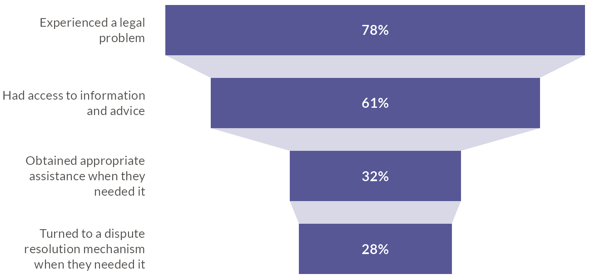

### 20. One-line labels

Without `label_width`, labels without breaks stay on one line and the label
column grows to fit the longest one.

```r
funnel(one_line, labels = "text")
```

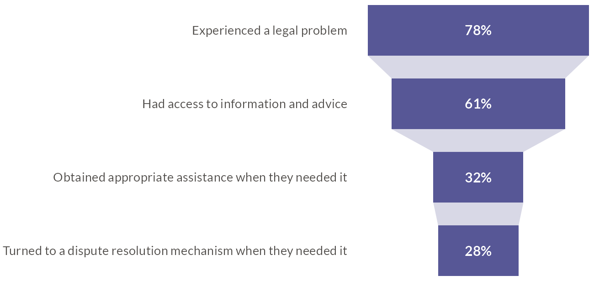

### 21. Label gap

`label_gap` is the space between the label column and the bars, in points
(default `16`).

```r
funnel(labels = "text", label_gap = 48)
```

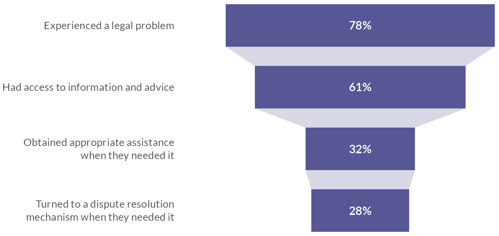

### 22. Label line height

`label_lineheight` is the distance between label baselines, in multiples of
the label size (default `1.22`).

```r
funnel(labels = "text", label_lineheight = 1.8)
```

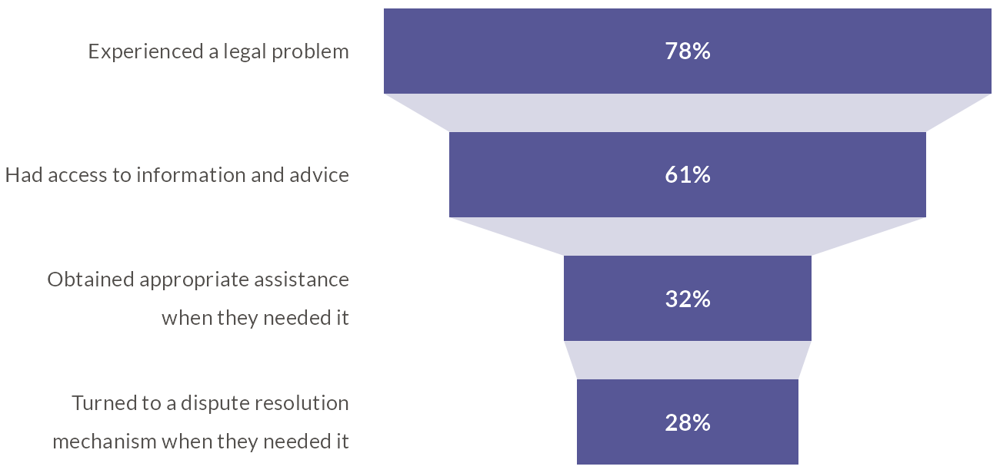

## Theme

### 23. Theme

`ptheme` elements that differ from `WJP_theme()` are applied last. The stage
labels sit in the left plot margin, so a ggplot title starts above the bars,
not above the labels.

```r
tinted <- WJP_theme() +
  ggplot2::theme(plot.background = ggplot2::element_rect(fill = "#F2F2F7", colour = NA))
funnel(labels = "text", ptheme = tinted, margins = c(12, 12, 12, 12))
```

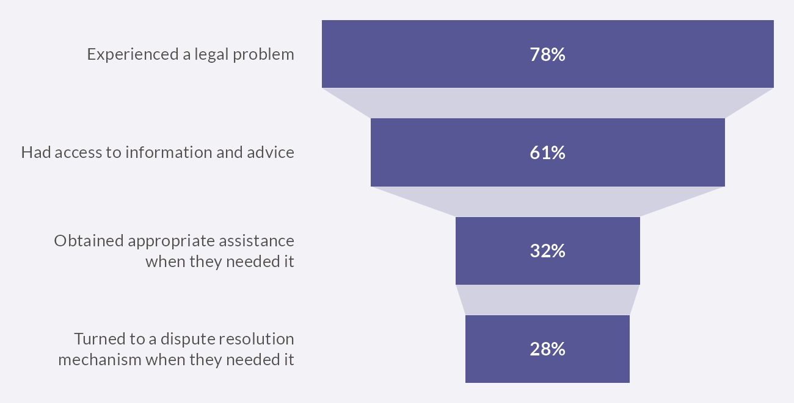

## Everything together

### 24. Everything together

```r
report <- one_line[c(3, 1, 4, 2), ]
report$text <- paste0(formatC(report$value, format = "f", digits = 1), "%")
wjp_funnel(
  report,
  target           = "value",
  grouping         = "stage",
  labels           = "text",
  order            = "rank",
  bar_height       = 34,
  color            = "#482d8b",
  connector_color  = "#A8A8C8",
  value_face       = "bold",
  value_size       = 12,
  value_color      = "#FFFFFF",
  label_size       = 10,
  label_colour     = "#524F4C",
  label_width      = 150,
  label_gap        = 20,
  label_lineheight = 1.3,
  width            = 468,
  margins          = c(8, 8, 8, 8)
)
```

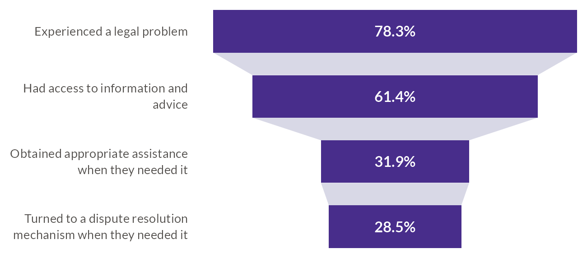
